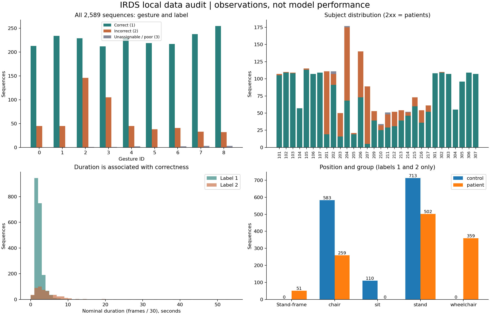
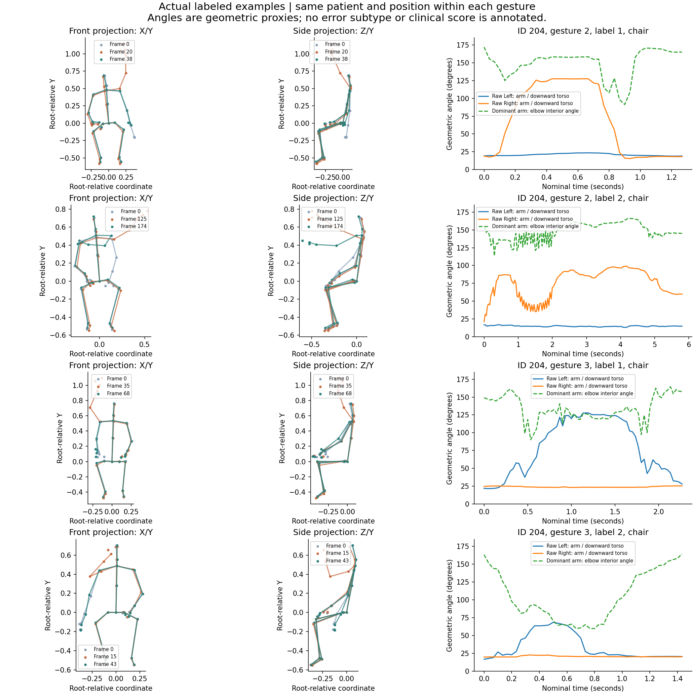

# IRDS 论文与本地数据评估

评估日期：2026-10-17。目标：明确现有数据可以研究哪些康复动作、识别哪些问题，以及用什么证据评价系统。

## 判断

IRDS 适合作为“真实患者上肢康复动作整体正确性判断”的主要候选数据。最有数据支持的起点是肩前屈：先研究 Gesture 2，之后用 Gesture 3 检查另一侧的可迁移性。它能够支持按动作重复进行正确/错误二分类，也能用于探索动作幅度、肘关节伸展和躯干运动等几何指标；它没有提供错误类型、错误发生时间或连续质量分数的真值，因此不能单凭原标签验证具体纠错反馈。

本次已完成论文全文阅读、重点表格/图示核对、全部 2,589 对骨架文件检查和实际动作可视化。没有训练分类模型；文中的分类评价方法是建议，图像和角度是探索结果。

## 1. 核心论文阅读记录：文章具体产出

**文献**：Miron et al., *IntelliRehabDS (IRDS)—A Dataset of Physical Rehabilitation Movements*, Data 2021, 6(5), 46。[论文 DOI](https://doi.org/10.3390/data6050046)。本地原文保留在 `../IRDS.pdf`，不随 GitHub 仓库发布。

**解决的问题**：既有康复动作数据中，错误动作经常由健康人刻意模拟。作者希望提供真实患者自然执行的正确/错误动作，使自动康复动作评估有真实数据依据。

**采集方法**：在马来西亚康复中心使用 Kinect One，标称 30 fps，记录 25 个身体关节。患者采用能够完成动作的体位；健康对照按要求在站立和坐姿下执行。两位标注者独立判断每次动作是否正确，分歧经共同复核解决。

| 具体产出 | 证据及用途 | 边界 |
|---|---|---|
| 九类康复动作数据集 | 每个文件为一次动作重复；包括真实患者和健康对照 | 动作不是为单一疾病设计，不能直接声称代表特定病种疗效 |
| Simplified 骨架文件 | 每帧 25×3=75 个坐标，适合直接构建时间序列 | 不含跟踪置信状态和时间戳 |
| RawData 骨架文件 | 含关节名称、跟踪状态、时间字段及二维投影 | 跟踪状态包含 Inferred 和 NotTracked；时间轴要单独核对 |
| 动作、体位、正确性标注 | 写在文件名中，可直接建立监督学习目标 | 正确性主要是整次动作的二元判断，无错误类型和逐帧标签 |
| 深度图 | 正文称另行提供与骨架对应的深度图 | 本地目录未发现对应深度图或 RGB 视频，二维坐标不是图像 |
| 数据分布、时长、个体差异分析 | 说明类别失衡、不同人/同一人动作变化及异常长序列 | 属于描述性验证，不是预测模型性能验证 |
| 标注一致性结果 | 报告一致率 88%，290 条记录共同复核 | 88% 是标注一致率，不能写成模型准确率；未报告 Kappa |
| 公开读取及 EDA 代码 | 官方仓库 https://github.com/alina-miron/intellirehabds ，本次已核对仓库目录与 README | 论文没有给出一套训练好的自动纠错系统及其基准成绩 |

论文第 5 节讨论 GAN、旋转、时间扭曲、噪声等增广方法，但没有发布增广后的数据，也没有在本文中完成增广对照实验。对我们最可借鉴的是采集场景、标注方式和真实错误样本，不应把它写成提出了某种新的分类算法。

许可证：论文标明数据使用 CC BY 4.0；官方代码仓库 README 也注明 CC BY 4.0，使用时保留论文引用。

## 2. 数据集比较表中的 IRDS 条目

| 比较字段 | 本次核实结果 |
|---|---|
| 数据内容 | 九类康复动作；25 关节三维骨架时间序列；RawData 有时间字段、跟踪状态和二维投影 |
| 文件规模 | 2,589 次动作，RawData 与 Simplified 各一份，共 5,178 个动作数据文件；两份格式不能当作独立样本 |
| 参与者规模 | 论文称 29 人：15 患者、14 健康人；本地为 30 个唯一 ID：14 个对照 ID、16 个 2xx ID。不能直接认定为 16 位不同患者，需核实额外 ID 217 |
| 标签 | 九类动作、体位、1 正确、2 错误、3 严重不良且无法可靠判定动作类别 |
| 二分类可用规模 | 标签 1/2 共 2,577 次，其中正确 2,047、错误 530 |
| 获取状态 | 骨架文件已到本地并全部读取验证；深度图和 RGB 视频未在本地发现 |
| 与课题的匹配 | 真实患者、上肢康复、整次动作质量二分类：较高；具体代偿类别/逐帧纠错：需要补充标注；连续临床评分：现有标签不足 |
| 独特价值 | 错误主要来自真实患者，不只是健康人模拟 |
| 主要限制 | 受试者少，重复样本和错误集中，左右命名不一致，缺少细粒度真值，多病种混合 |

以下仅为论文 Related Work 提供的比较线索，尚未独立核对另外三个数据集的原论文、实际文件或获取状态，不视为完成它们的阅读和检查：

| 数据集 | IRDS 论文中的介绍 | 对后续比较的启发 |
|---|---|---|
| UI-PRMD | 10 名健康人、10 类动作、正确与刻意错误执行，Vicon/Kinect | 比较动作覆盖及模拟错误和真实错误的差别 |
| KIMORE | 78 人：44 对照、34 患者；5 类偏下背康复动作，含骨架、RGB/深度及评分相关信息 | 若目标偏连续质量评分，应优先核对其评分标签 |
| TRSP | 卒中康复场景；文中介绍逐帧的无代偿、前倾、抬肩、躯干旋转标签 | 若目标偏具体代偿检测，应优先核对动作与代偿标签的匹配性 |

## 3. 数据检查结果

### 3.1 可读取性与格式

- 2,589 个 Simplified 文件全部成功读取，每帧恰好 75 列，没有 NaN 或无穷值；坐标全为有限数值不代表跟踪和解剖学意义必然正确。
- RawData 与 Simplified 文件名集合完全对应，逐帧三维坐标在全部文件中数值完全一致。
- 基于完整坐标数组的精确重复检查没有发现相同序列；这不排除高度相似的重复动作，也不消除按人划分的必要性。
- 24 个 RawData 文件有重复 `Version0.1` 行。读取器应跳过所有版本头；官方读取代码也会跳过含 Version 的行。不是 24 个样本不可用。
- RawData 共 5,707,525 个“帧×关节”记录，其中 Tracked 5,450,804、Inferred 256,712（约 4.50%）、NotTracked 9。应保留质量掩码，不能把推断值当作实测值。
- 379 条序列至少出现一次原始帧 ID 非连续递增 1；4 条序列存在相邻时间字段差超过 1,000 原始单位。本次没有发现时间字段倒退或相等。标称 30 fps 不等于每段时间轴均匀，速度、加速度、平滑度研究必须先核实时间单位和重采样规则。
- 文件名 DateID 全是 18，不能据此构建多天纵向恢复趋势，也不能把它解释成已经确认的实际日期。

### 3.2 人数与论文不一致

本地有 30 个唯一 ID。对照为 101–107 和 301–307，共 14 个；2xx 为 201–207、209–217，共 16 个，208 不存在。217 有 61 次动作，论文 Table 2 未列出其人口学信息，但 Figure 9 的横轴包含 217。

因此存在论文叙述/元数据与文件记录不一致，尚不能判断 217 是新增患者、某人的重编号或其他情况。报告应同时列“论文人数”和“唯一文件 ID 数”。正式划分训练/测试前应核实 ID 对应的真实个人；若无法核实，保留不确定性并做包含/排除 217 的敏感性分析，不能静默删除或编造人口学信息。

### 3.3 九类动作与标签分布

下表动作中文名按论文 Table 1；左右与 RawData 的关节命名存在下述对应差异。

| ID | 动作 | 正确 1 | 错误 2 | 特殊 3 | 1/2 样本数 | 错误样本涉及的不同 ID 数 |
|---:|---|---:|---:|---:|---:|---:|
| 0 | 左肘屈伸 | 213 | 45 | 0 | 258 | 9 |
| 1 | 右肘屈伸 | 234 | 45 | 0 | 279 | 9 |
| 2 | 左肩前屈 | 229 | 146 | 1 | 375 | 10 |
| 3 | 右肩前屈 | 212 | 105 | 1 | 317 | 9 |
| 4 | 左肩外展 | 230 | 45 | 2 | 275 | 11 |
| 5 | 右肩外展 | 219 | 38 | 0 | 257 | 8 |
| 6 | 双臂前举上抬 | 217 | 41 | 2 | 258 | 6 |
| 7 | 左侧点地 | 238 | 33 | 3 | 271 | 8 |
| 8 | 右侧点地 | 255 | 32 | 3 | 287 | 8 |
| 合计 | | 2,047 | 530 | 12 | 2,577 | 不可将各行动作人数相加 |

标签 3 是语义特殊的数据，建议从首轮正确/错误分类中排除并保留清单；后续可以单独研究拒判或严重异常，不能直接与普通标签 2 混合后继续称为原论文二分类设置。

### 3.4 正确性、患者身份和体位混杂

| 文件 ID 分组 | 正确 1 | 错误 2 | 特殊 3 |
|---|---:|---:|---:|
| 健康对照 ID | 1,399 | 7 | 0 |
| 2xx ID | 648 | 523 | 12 |

530 次错误中 523 次来自 2xx ID，占 98.68%。Gesture 2 的 146 次错误中，201、203、204 三个 ID 提供了 121 次，约 82.9%。一百多次错误不等于一百多个独立的患者案例。

排除标签 3 后：stand 1,215、chair 842、sit 110、wheelchair 359、Stand-frame 51。chair 与 sit 合计 952，符合论文汇总的普通坐姿数；sit 全部来自 306/307，是否与 chair 完全等价应在映射中说明，原始标签应保留。

轮椅和支撑架记录仅来自 2xx ID，体位可能成为身份线索。模型需要证明学到的是动作质量，而不只是人群、椅子姿态或整体活动能力。应报告仅患者子集和按体位分层的结果。

### 3.5 左右命名的系统差异

以“上臂与向下躯干向量的三维夹角峰值”对比左右两条原始关节链。在健康对照且标签为正确的四类肩部动作中：

| 论文动作 ID 与名称 | 检查的正确对照序列 | 峰值更大的原始关节链 |
|---|---:|---|
| 2 左肩前屈 | 153 | 153/153 为 RawData 的 Right |
| 3 右肩前屈 | 151 | 151/151 为 RawData 的 Left |
| 4 左肩外展 | 157 | 157/157 为 RawData 的 Right |
| 5 右肩外展 | 155 | 155/155 为 RawData 的 Left |

这证明论文左右动作名与原始关节链命名之间存在一致的对应差异；仅靠骨架不能确定是镜像约定、动作命名还是采集程序的问题。不能只凭画面左右确定患者解剖学左右。本次没有修改原始数据。应保留 GestureID，显式记录 `gesture_label_side` 与 `raw_joint_side`，必要时用双侧特征或运动侧对齐；在给出左右纠错反馈前核实对应关系。

### 3.6 时长与实际可视化

标签 1/2 共 2,577 条，长度 13–1,586 帧，均值 84.85 帧；正确均值 68.43、错误均值 148.26。若包含标签 3，最长为 4,736 帧，不能把论文排除标签 3 后的最大值套用到全体文件。

整体上正确样本占 79.43%，所以“永远预测正确”已能得到约 79.4% accuracy。这是类别分布计算得到的参考线，不是训练或测试模型的成绩。

已可视化 ID 204、普通坐姿、Gesture 2/3 的正确与错误各一条，包含正面/侧面投影、起始/峰值/结束姿态和双侧几何角度曲线：

| 文件 | 原始标签 | 运动更明显的关节链 | 上臂/躯干夹角峰值 |
|---|---|---|---:|
| 204_18_2_14_1_chair.txt | 正确 | Raw Right | 127.45° |
| 204_18_2_19_2_chair.txt | 错误 | Raw Right | 99.26° |
| 204_18_3_54_1_chair.txt | 正确 | Raw Left | 127.77° |
| 204_18_3_7_2_chair.txt | 错误 | Raw Left | 68.50° |

这些是固定样本的观察，不是总体显著性检验，也不证明“角度小于某值”就是错误的真实原因。角度为 Kinect 几何代理量，不能直接视为临床测角仪读数；标签正确的样本也未必达到某个教科书最大角度。图中的时间由帧数/30 得到，仅表示标称时间，分析速度时必须改用核实后的时间字段。

## 4. 初步课题范围与评价证据

### 推荐起点

**题目范围建议**：“基于三维骨架的真实患者肩前屈动作正确性评估与可解释运动特征分析”。以已切分、已知动作类型的一次肩前屈为输入，输出整次动作正确/错误，并展示运动幅度、肘关节伸展程度和躯干运动的探索性指标。

先研究 Gesture 2（229 正确、146 错误，375 次），用 Gesture 3（212 正确、105 错误，317 次）作为扩展。两类合计 692 次有效动作、251 次错误；左右语义核实前以 GestureID 表达。左右肩前屈是同一运动家族的两侧，不应宣传为两个完全不同的康复任务。如果课题必须覆盖两种不同运动，可将肩外展作为第二候选，但其每侧错误只有 38–45 次。

主任务暂不限定某一种疾病；现有元数据不足以可靠地定义卒中专属队列并验证疾病疗效。数据已按次切分，暂不把连续流动作分割、自动计数或实时预警纳入已得到验证的范围。

体位优先采用坐姿场景探索，同时保留对全体体位的分层实验。Gesture 2 单站姿仅 14 次错误，而普通 chair 有 52 次错误、wheelchair 有 78 次错误；不要在没核对分布前直接限定为站姿并声称样本充足。普通坐姿和轮椅应分别报告，暂不假定它们完全等价。

### 研究问题与证据之间的关系

| 想要输出的判断 | 现有数据可计算什么 | 现有标签能否直接验证 | 所需补充 |
|---|---|---|---|
| 整次动作正确/错误 | 姿态轨迹、时序特征、分类分数 | 可以，用标签 1/2 | 受试者分组评价及质量控制 |
| 动作幅度不足 | 上臂相对躯干角度、手腕轨迹与高度 | 不能单独验证该错误类别 | 对固定样本补充幅度不足的专家判断/规则定义 |
| 肘部未伸直 | 肩-肘-腕夹角及其与动作阶段的关系 | 不能单独验证该错误类别 | 补充屈肘标签，可与其他错误并存 |
| 躯干前倾或侧倾代偿 | 躯干方向、肩髋相对变化 | 不能直接验证代偿类别 | 专家核对代偿类型，必要时对照视频 |
| 动作不平滑或过慢 | 核实时标后的速度、加速度及阶段时长 | 无平滑度/过慢的真值 | 先处理时标和跟踪误差，再定义标注 |
| 连续质量分数/临床改善 | 可以构造任意代理分数 | 无连续评分及可靠纵向真值 | 另找评分数据或重新采集/评分 |

### 如何评价是否做对

1. 以真实个人分组，采用按人留出或分组交叉验证。一个人的不同动作、重复、体位必须在同一组。ID 217 归属尚未解决，使用文件 ID 只是暂时分组。左右侧数据也不能跨集合泄漏。
2. 仅在训练部分拟合归一化参数、参考轨迹和阈值；增广、类别权重和参数选择不得接触外层测试数据。采用独立验证集或分组嵌套验证选择模型。
3. 以错误为阳性，报告错误召回率、错误 precision/F1、macro-F1、balanced accuracy 和混淆矩阵；PR-AUC 可作为分数模型的补充。accuracy 单独不足以说明效果。
4. 建立三个层次的参考：多数类预测；仅使用时长/帧数的简单模型；使用几何和轨迹特征的可解释模型。时长与标签相关，不把基于时长的效果自动解释为学会了姿态纠错。
5. 按动作、患者子集、体位和每个受试者报告表现。部分留出受试者可能只包含一种标签，不应把不存在的召回率当成 0 或当成成功；给出汇总的外层预测和可计算的分组指标。
6. 置信区间应以受试者为重采样单位，不能把同一个人的重复当成独立患者。错误集中在少数 ID，汇总结果需同时展示按人的稳定性。
7. 做有针对性的敏感性检查：ID 217 包含/排除；跟踪质量筛选前后；时长输入有/无；按体位及患者子集结果。不要因为测试错误再临时改筛选标准。

这里可以证明的是“对未见过的受试者，整体正确性判断是否与现有人工标签一致”。若要证明系统准确解释了原因，必须单独使用原因标签；若要证明临床 ROM 测量准确，还需测量参照或专家评估，二分类标签不够。

### 是否需要补充采集

- **第一轮整体正确性实验**：现有骨架足以开始，暂时不必为了训练立即采集新数据。
- **具体错误反馈**：优先补充已有样本的专家标注。先对固定、跨人的代表性样本建立“幅度不足/肘部弯曲/躯干代偿/无法判断”的多标签规范，保留标注者分歧及复核记录。骨架无法可靠判断时需要对应视频或新采集，不能强行定类。
- **普通摄像头或手机演示**：当前 Kinect 骨架不能直接证明 RGB 姿态估计在真实拍摄下可靠。需要少量目标设备视频，覆盖坐姿/站姿、遮挡和左右方向，最好有同步或专家参照。健康人模拟适合检查管线，不足以证明真实患者泛化。
- **连续临床评分或恢复趋势**：需要另一个具有评分/纵向信息的数据源或专门采集；不建议由 IRDS 的 1/2 标签映射成 0–100 分后称为临床评分。

## 本次成果清单与完成边界

| 第一阶段预期成果 | IRDS 本次完成内容 | 尚未完成 |
|---|---|---|
| 数据集比较表 | 已填写本地核实的 IRDS 条目，列出其他数据集比较线索 | 其他数据集的原文阅读、下载与实际核对 |
| 核心论文阅读记录 | 本文件第 1 节：问题、采集/标注方法、具体成果、可借鉴与局限 | 后续方法论文和比较数据集论文 |
| 数据检查 | 全量读取、坐标对应核对、人数/动作/标签/体位/时长/跟踪状态、实际可视化 | 217 身份和左右语义的外部确认；具体错误标签的专家核验 |
| 初步课题范围 | 肩前屈整体正确性及解释性运动特征；评价设计和补充采集条件 | 最终选题需结合其他候选数据的证据再定 |

## 可复查文件

- `audit_irds.py`：检查与绘图脚本，只读取源数据。
- `audit_summary.json`：全量汇总及异常检查。
- `sample_manifest.jsonl`：2,589 次动作的标签、ID、体位、帧数、跟踪和时间检查记录。
- `visualized_samples.json`：图中四个具体样本与几何测量。
- `data_overview.png`、`shoulder_examples.png`：可直接查看的可视化。
- `IRDS_extracted.txt`：全文提取，用于检索；论文图表以 PDF 为准。

从仓库根目录复现：`python IRDS/analysis/audit_irds.py`，需先取得源数据，详见 [复现与数据来源说明](../../docs/REPRODUCIBILITY_zh.md)。本次环境使用 NumPy 与 Matplotlib。所有派生文件位于 `analysis`，原论文和源数据未改动。

发布说明（2026-11-08）：本报告保留 2026-10-17 的审计结论和早期建议。肩前屈现为待比较候选，未最终定题；全文提取、论文页面截图和原始数据保留本地，仓库提供原创分析与派生成果。
