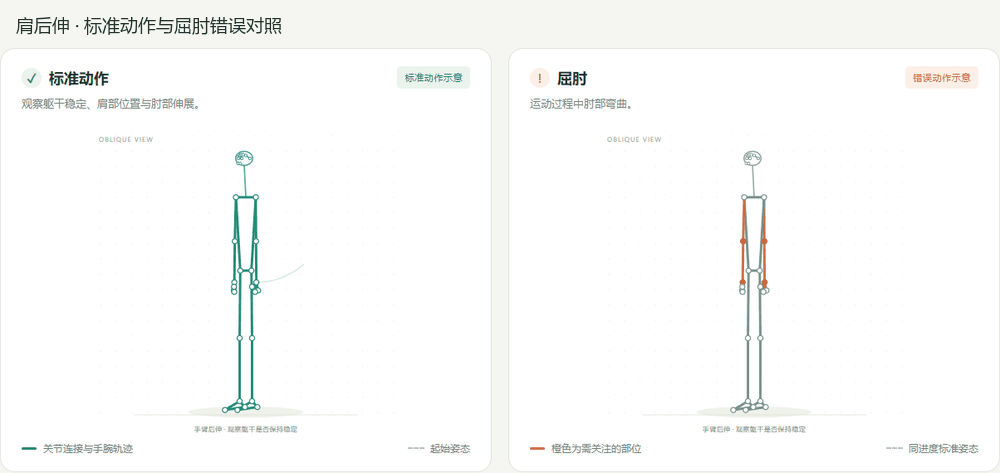
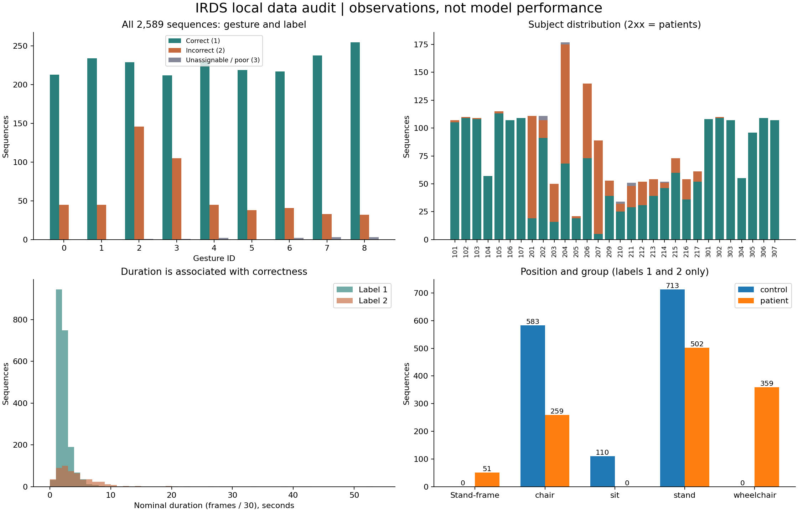

# FYP：基于公开数据的康复动作模型训练研究

利用公开骨架数据研究康复动作的具体错误识别，当前使用 **REHAB26-ViewAngles** 的肩外展、肩后伸动作。首页展示动作动画、当前最佳结果及可追溯来源。

更新：**2026-11-10**。实验环境为 `conda activate fyp`；已完成50次首轮基线、928次Transformer v2拟合，以及984次融合与输入对照拟合。

## 当前最佳实验结果

以下均为**本仓库实验成绩**，不是数据集论文中的分数。两个动作分别训练，采用五人外层留一测试、内层轮流验证，输出五种错误的多标签概率。

| 动作与范围 | 当前最佳方案 | macro-F1 | 种子情况 | 配置与来源 |
|---|---|---:|---|---|
| **肩后伸：当前最高分** | **三视角骨架等权融合 + 两层Transformer** | **0.734** | 1个种子 | [完整设定](experiments/rehab26_fusion_v3/BEST_SETTINGS_zh.md#shoulder-extension) |
| 肩后伸：已完成三种子最高 | Transformer + 三视角概率平均 + 验证重选阈值 | 0.690 ± 0.029 | 3个种子 | [选择与配置来源](experiments/rehab26_fusion_v3/BEST_SETTINGS_zh.md#已完成三种子的transformer方案) |
| **肩外展：所有模型最高** | **角度随机森林 + 三视角概率平均 + 验证重选阈值** | **0.641 ± 0.005** | 3个种子 | [完整设定](experiments/rehab26_fusion_v3/BEST_SETTINGS_zh.md#shoulder-abduction) |
| 肩外展：Transformer最高 | Transformer + 三视角概率平均 + 验证重选阈值 | 0.570 ± 0.018 | 3个种子 | [逐种子指标](experiments/rehab26_fusion_v3/best_results.json) |

±为训练种子样本标准差。肩后伸0.734仍待额外种子确认，其误警率/漏警率为19.1%/9.7%；肩外展随机森林的误警率仍为54.3%。完整结果同时保留误警、漏警、逐人和逐错误类别指标。

**最高分Transformer设定**：96帧 × 69维输入，三路骨架做中心/尺度/固定yaw对齐后等权融合；2层、64维、4头注意力，GELU、Pre-LN、dropout=0.1，BCEWithLogitsLoss不加类别权重；AdamW，学习率0.0003，weight decay=0.001，batch=32，最多80 epoch，验证AP早停。

[最佳设定与来源](experiments/rehab26_fusion_v3/BEST_SETTINGS_zh.md) · [完整结果](experiments/rehab26_fusion_v3/RESULTS_zh.md) · [结构化证据](experiments/rehab26_fusion_v3/best_results.json) · [冻结配置](experiments/rehab26_fusion_v3/protocol.final.json) · [模型核验](experiments/rehab26_fusion_v3/verification_models.json)

## SVG 标准动作与错误示范

使用MediaPipe风格的33点骨架：**左侧绿色为标准动作，右侧橙色突出错误涉及部位**。下方为动作原理示意，幅度用于绘图表达；不是模型实时检测结果。

### 肩后伸：标准动作与屈肘错误

[](demos/rehab_motion_svg/shoulder_extension_comparison.svg)

[原生SVG：标准 + 躯干前倾、屈肘、耸肩、躯干旋转、手臂外偏](demos/rehab_motion_svg/shoulder_extension_comparison.svg)

### 肩外展：标准动作与幅度不足

[](demos/rehab_motion_svg/shoulder_abduction_comparison.svg)

[原生SVG：标准 + 幅度不足、屈肘、耸肩、手臂前偏、头部侧倾](demos/rehab_motion_svg/shoulder_abduction_comparison.svg)

首页使用GIF预览，原生SVG下载后可在Chrome/Edge中循环播放。[下载交互演示HTML](https://github.com/5555dfdf/FYP/raw/refs/heads/main/demos/rehab_motion_svg/demo.html)，离线打开即可暂停、拖动进度、慢放、切换视角和错误类型、叠加标准骨架。另有[12个单独SVG动画](demos/rehab_motion_svg/svg/)及[演示说明与生成代码](demos/rehab_motion_svg/README.md)。

## 数据、论文与结果来源

- **数据**：[REHAB26-ViewAngles](https://doi.org/10.5281/zenodo.23018128)，本轮使用5位志愿者的1111次动作、3333个相机观察；解析、标签及边界检查见[数据审计](docs/REHAB26_AUDIT_zh.md)。
- **配套论文**：Jánošová et al., *Impact of Patient Orientation in Single- and Multi-View Camera Environments for AI-based Rehabilitation Monitoring*, [arXiv:2609.35726](https://arxiv.org/abs/2609.35726)。论文评价方式与当前跨人五错误分类不同，具体对照见[文献核查](literature/2026-11-09_rehab26_methods/review_memo_zh.md)。
- **成绩证据**：[best_results.json](experiments/rehab26_fusion_v3/best_results.json)直接从[完整汇总](experiments/rehab26_fusion_v3/results_summary.json)提取，保留定位键、逐种子指标和源文件SHA-256；[分析脚本](experiments/rehab26_fusion_v3/analyze.py)与[最佳结果导出脚本](experiments/rehab26_fusion_v3/export_best_results.py)可检查计算方式。
- **融合参考**：核查MediaPipe三角测量、Pose2Sim、FreeMoCap等GitHub实现后，独立实现当前中心/尺度/yaw对齐与等权/可见度融合。[适配记录](literature/2026-11-10_skeleton_fusion/REVIEW_zh.md)列出实际检查的代码、固定提交及输入要求；当前没有标定三角测量。

本轮984个模型重载通过，并复现10次原始三视图到集成预测的完整过程。原始数据和权重保留本地；公开演示使用自行构建的动作示意，真实标注回放可在取得数据后本地生成。

## 建议从这里开始

| 你想了解什么 | 阅读入口 |
|---|---|
| 标准与错误动作如何展示 | [SVG/GIF动画](demos/rehab_motion_svg/README.md)、[交互演示文件](demos/rehab_motion_svg/demo.html) |
| 哪套设定目前最好、成绩从哪里来 | [最佳结果与来源](experiments/rehab26_fusion_v3/BEST_SETTINGS_zh.md) |
| 三视角怎样融合、实际有没有收益 | [融合结论](experiments/rehab26_fusion_v3/FINDINGS_zh.md)、[完整结果](experiments/rehab26_fusion_v3/RESULTS_zh.md) |
| GitHub融合实现能否接入现有数据 | [代码与输入假设核查](literature/2026-11-10_skeleton_fusion/REVIEW_zh.md) |
| 哪些方向值得做、各自如何验证 | [研究方向与决策问题](docs/RESEARCH_DIRECTIONS_zh.md) |
| 我们已经完成什么、有什么可复查结果 | [现有成果与证据边界](docs/COMPLETED_WORK_zh.md) |
| 目前进度和下一阶段工作 | [项目状态](PROJECT_STATUS_zh.md) |
| 首选数据能否解析、有哪些未解决问题 | [REHAB26 本地审计](docs/REHAB26_AUDIT_zh.md) |
| 历史v2模型效果、基础因素影响与模型入口 | [Transformer实验结论](experiments/rehab26_transformer_v2/FINDINGS_zh.md) |
| 完整逐人/逐类测试与学习曲线 | [Transformer实际结果](experiments/rehab26_transformer_v2/RESULTS_zh.md) |
| 如何重跑训练和加载权重推理 | [v2实验复现入口](experiments/rehab26_transformer_v2/README.md) |
| 论文之间有什么关系、读到了哪一层 | [33 篇候选论文比较表](literature/2026-11-06/paper_matrix_zh.md) |
| 哪些数据真正能支持目标、是否可取得 | [数据集比较](literature/2026-11-06/dataset_comparison_zh.md) |
| 代表论文的判断、限制和阅读安排 | [扩大调研记录](literature/2026-11-06/review_memo_zh.md) |

## 早期比较过的研究路线

| 候选路线 | 模型输出 | 数据依据 | 当前最关键的未知数 |
|---|---|---|---|
| 跨受试者的动作正确性评估 | 正确/错误概率 | IRDS；REHAB24-6 待实际解析 | 模型能否识别未见过的人的动作质量，是否依赖时长或人群线索 |
| 具体错误分类与定位 | 错误类别，可能扩展部位或时间段 | KERAAL；UCDHE 待追溯 | 已标注独立患者/错误数量，以及原始标注能否稳定解析 |
| 总体与分项质量评分 | 总分与目标完成、姿态约束等分项 | KIMORE；MobiPhysio 待取得 | 评分粒度、范围、缺失及多项标签是否实际可用 |
| 少标注下的多动作预训练与迁移 | 共享编码器 + 分类/评分输出 | 需要可得且可对齐的源/目标数据 | 在严格按人测试下，是否优于从零训练；哪些条件会负迁移 |
| 面向 RGB 姿态误差的鲁棒评估 | 从估计骨架预测质量 | REHAB24-6；其他模态配对数据待核对 | 姿态误差与质量错误能否区分，双视角和动捕是否可正确对齐 |

这些路线尚未确定为研究创新。对比学习、迁移学习、图网络、错误分类均已有相关工作，研究问题需要在全文阅读和基线实验后进一步收敛。具体假设、最小实验和停止条件见[研究方向文档](docs/RESEARCH_DIRECTIONS_zh.md)。

## 已有可检查成果

- **REHAB26 实际训练**：1111次肩部动作、3333个单摄像头观察；5轮按人测试、5种配置、2种动作，共50个已拟合模型。宏F1、逐类指标、视角分析、固定噪声诊断和可靠性覆盖率见[结果报告](experiments/rehab26_v1/RESULTS_zh.md)。目前误警较多，不能声称已具备可靠临床警示能力。
- **IRDS 全量骨架审计**：2,589 次动作，RawData 与 Simplified 成对核对；检查格式、标签、人数、体位、时长、跟踪和时间异常。
- **数据分布与真实样本可视化**：包含肩前屈同人同体位的正确/错误示例和几何角度曲线。图表反映数据观察，不是训练成绩。
- **文献与数据比较**：33 篇核心候选登记，标明全文重点核对、摘要核对或元数据核对；数量包含此前已涉及的文献。
- **资源可获取性记录**：区分论文提供入口、元数据可访问、实际下载与全量验证。FineRehab 项目页在 2026-11-06 仍写即将发布，暂不能作为确定训练依赖。
- **已有实验脚本草稿**：[肩前屈传统模型基线](IRDS/experiments/shoulder_pilot_20261106/README.md)。发布检查时未发现运行结果或权重，尚未计作训练成果。



## 目录

```text
docs/                         # 研究路线、成果说明、复现与数据来源
demos/rehab_motion_svg/        # SVG/GIF示范与离线交互播放器
experiments/rehab26_fusion_v3/ # 最新融合对照、最佳设定与成绩证据
experiments/rehab26_transformer_v2/ # Transformer嵌套验证与共享训练实现
experiments/rehab26_v1/        # 实际样本处理、训练、推理、验证及首轮结果
IRDS/
  IRDS_followup_literature_review_zh.md
  analysis/
    audit_irds.py             # 数据审计与绘图脚本
    IRDS_assessment_zh.md     # 审计与原论文评估
    audit_summary.json       # 全量汇总
    sample_manifest.jsonl    # 每次动作的派生检查记录
    visualized_samples.json
    data_overview.png
    shoulder_examples.png
literature/2026-11-06/
  paper_matrix_zh.md         # 论文表
  paper_registry.json       # 结构化书目与阅读状态
  dataset_comparison_zh.md
  review_memo_zh.md
  source_inventory.json     # 本地证据文件的哈希与大小索引
  *.py                      # 检索、获取与登记脚本
```

原始骨架、第三方论文全文、提取文本和下载日志留在本地，不随研究材料提交。数据和论文的权利与使用条件由各自来源决定；仓库中的来源链接不授予其重新分发权。

## 复现与下一步

安装研究资料处理所需依赖：

```bash
python -m pip install -r requirements-research.txt
```

IRDS 审计需要先从[原始数据来源](https://doi.org/10.5281/zenodo.4610859)取得并解压数据，再按[复现说明](docs/REPRODUCIBILITY_zh.md)运行。论文表可由已提交的结构化登记离线重新生成。

多种子与内层验证者轮换已在v2和加权融合v3完成。下一阶段优先预先固定等权融合确认、复核耸肩/屈肘等难类与三视图对齐、引入新受试者，并开发视频回放；不能反复用已查看的测试调参再宣称独立验证。肩后伸可优先展示，肩外展保留传统对照。KERAAL仍为后续候选，视频压缩包暂缓下载。
