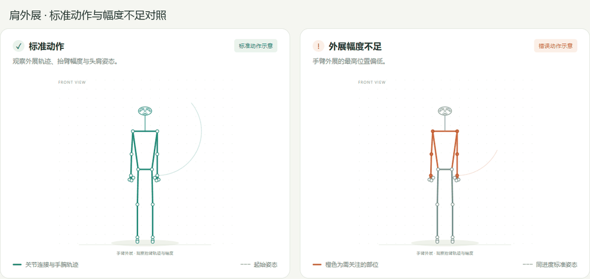
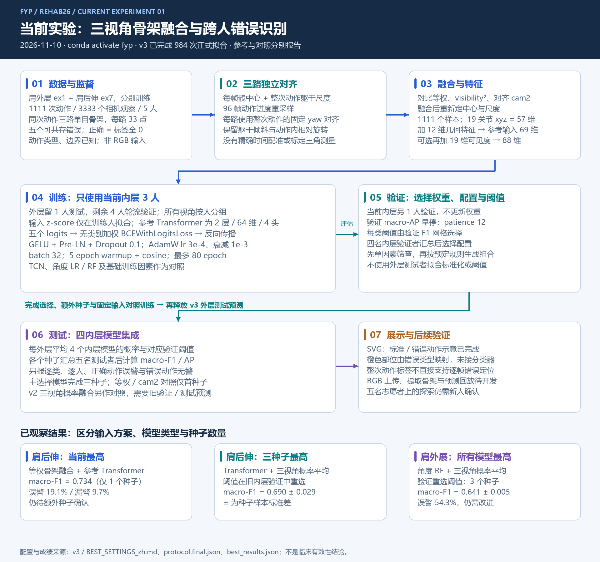

# FYP：基于公开数据的康复动作模型训练研究

利用公开骨架数据研究康复动作的具体错误识别，当前使用 **REHAB26-ViewAngles** 的肩外展、肩后伸动作。首页展示动作动画、当前最佳结果及可追溯来源。

更新：**2026-11-10**。实验环境为 `conda activate fyp`；已完成50次首轮基线、928次Transformer v2拟合，以及984次融合与输入对照拟合。

## 当前最佳实验结果

以下均为**本仓库实验成绩**，不是数据集论文中的分数。两个动作分别训练，采用五人外层留一测试、内层轮流验证，输出五种错误的多标签概率。

| 动作与范围 | 当前最佳方案 | macro-F1 | 种子情况 | 配置与来源 |
|---|---|---:|---|---|
| **肩后伸：当前最高分** | **三视角骨架等权融合 + 两层Transformer** | **0.734** | 1个种子 | [完整设定](experiments/rehab26_fusion_v3/BEST_SETTINGS_zh.md#shoulder-extension) |
| 肩后伸：已完成三种子最高 | Transformer + 三视角概率平均 + 验证重选阈值 | 0.690 ± 0.029 | 3个种子 | [选择与配置来源](experiments/rehab26_fusion_v3/BEST_SETTINGS_zh.md#已完成三种子的transformer方案) |
| **肩外展：所有模型最高** | **角度随机森林 + 三视角概率平均 + 验证重选阈值** | **0.641 ± 0.005** | 3个种子 | [完整设定](experiments/rehab26_fusion_v3/BEST_SETTINGS_zh.md#shoulder-abduction) |
| 肩外展：Transformer最高 | Transformer + 三视角概率平均 + 验证重选阈值 | 0.570 ± 0.018 | 3个种子 | [逐种子指标](experiments/rehab26_fusion_v3/best_results.json) |

±为训练种子样本标准差。肩后伸0.734仍待额外种子确认，其误警率/漏警率为19.1%/9.7%；肩外展随机森林的误警率仍为54.3%。完整结果同时保留误警、漏警、逐人和逐错误类别指标。

**最高分Transformer设定**：96帧 × 69维输入，三路骨架做中心/尺度/固定yaw对齐后等权融合；2层、64维、4头注意力，GELU、Pre-LN、dropout=0.1，BCEWithLogitsLoss不加类别权重；AdamW，学习率0.0003，weight decay=0.001，batch=32，最多80 epoch，验证AP早停。

[最佳设定与来源](experiments/rehab26_fusion_v3/BEST_SETTINGS_zh.md) · [完整结果](experiments/rehab26_fusion_v3/RESULTS_zh.md) · [结构化证据](experiments/rehab26_fusion_v3/best_results.json) · [冻结配置](experiments/rehab26_fusion_v3/protocol.final.json) · [模型核验](experiments/rehab26_fusion_v3/verification_models.json)

## SVG 标准动作与错误示范

使用MediaPipe风格的33点骨架：**左侧绿色为标准动作，右侧橙色突出错误涉及部位**。下方为动作原理示意，幅度用于绘图表达；不是模型实时检测结果。

### 肩后伸：标准动作与屈肘错误

[](demos/rehab_motion_svg/shoulder_extension_comparison.svg)

[原生SVG：标准 + 躯干前倾、屈肘、耸肩、躯干旋转、手臂外偏](demos/rehab_motion_svg/shoulder_extension_comparison.svg)

### 肩外展：标准动作与幅度不足

[](demos/rehab_motion_svg/shoulder_abduction_comparison.svg)

[原生SVG：标准 + 幅度不足、屈肘、耸肩、手臂前偏、头部侧倾](demos/rehab_motion_svg/shoulder_abduction_comparison.svg)

首页使用GIF预览，原生SVG下载后可在Chrome/Edge中循环播放。[下载交互演示HTML](https://github.com/5555dfdf/FYP/raw/refs/heads/main/demos/rehab_motion_svg/demo.html)，离线打开即可暂停、拖动进度、慢放、切换视角和错误类型、叠加标准骨架。另有[12个单独SVG动画](demos/rehab_motion_svg/svg/)及[演示说明与生成代码](demos/rehab_motion_svg/README.md)。

## 数据、论文与结果来源

- **数据**：[REHAB26-ViewAngles](https://doi.org/10.5281/zenodo.23018128)，本轮使用5位志愿者的1111次动作、3333个相机观察；解析、标签及边界检查见[数据审计](docs/REHAB26_AUDIT_zh.md)。
- **配套论文**：Jánošová et al., *Impact of Patient Orientation in Single- and Multi-View Camera Environments for AI-based Rehabilitation Monitoring*, [arXiv:2609.35726](https://arxiv.org/abs/2609.35726)。论文评价方式与当前跨人五错误分类不同，具体对照见[文献核查](literature/2026-11-09_rehab26_methods/review_memo_zh.md)。
- **成绩证据**：[best_results.json](experiments/rehab26_fusion_v3/best_results.json)直接从[完整汇总](experiments/rehab26_fusion_v3/results_summary.json)提取，保留定位键、逐种子指标和源文件SHA-256；[分析脚本](experiments/rehab26_fusion_v3/analyze.py)与[最佳结果导出脚本](experiments/rehab26_fusion_v3/export_best_results.py)可检查计算方式。
- **融合参考**：核查MediaPipe三角测量、Pose2Sim、FreeMoCap等GitHub实现后，独立实现当前中心/尺度/yaw对齐与等权/可见度融合。[适配记录](literature/2026-11-10_skeleton_fusion/REVIEW_zh.md)列出实际检查的代码、固定提交及输入要求；当前没有标定三角测量。

本轮984个模型重载通过，并复现10次原始三视图到集成预测的完整过程。原始数据和权重保留本地；公开演示使用自行构建的动作示意，真实标注回放可在取得数据后本地生成。

## 当前实验与复现入口

| 内容 | 入口 |
|---|---|
| 当前进度与下一步 | [项目状态](PROJECT_STATUS_zh.md) |
| 最佳配置、成绩与来源 | [最佳设定](experiments/rehab26_fusion_v3/BEST_SETTINGS_zh.md) |
| 融合方法、完整结果与训练命令 | [v3实验](experiments/rehab26_fusion_v3/README.md)、[结果](experiments/rehab26_fusion_v3/RESULTS_zh.md) |
| 实验流程与网络结构 | [当前架构说明](docs/TRANSFORMER_EXPERIMENT_DESIGN_zh.md) |
| 环境、数据准备和运行依赖 | [复现说明](docs/REPRODUCIBILITY_zh.md) |
| 数据结构、标签与同步限制 | [REHAB26数据审计](docs/REHAB26_AUDIT_zh.md) |
| 已完成工作 | [成果记录](docs/COMPLETED_WORK_zh.md) |
| 后续改进问题 | [研究方向](docs/RESEARCH_DIRECTIONS_zh.md) |



当前v3复用v2的模型与训练实现，以及v1的骨架预处理。**这些旧版本仍是当前实验依赖**；v2保存的预测还用于三视角概率融合对照。正式协议、结果和核验记录保留各自的阶段含义。

## 目录与历史材料

```text
demos/rehab_motion_svg/           # 公开SVG/GIF与离线交互演示
experiments/rehab26_fusion_v3/    # 当前融合实验、最佳设定与成绩来源
experiments/rehab26_transformer_v2/ # 共享模型/训练实现、单视角实验与预测来源
experiments/rehab26_v1/           # 共享骨架预处理、首轮基线与复现代码
docs/                            # 当前架构、数据审计、复现和研究计划
literature/                       # 按日期保存的文献与融合实现核查
IRDS/analysis/                    # 早期IRDS数据审计与可视化（历史）
```

早期材料保留为研究背景：[IRDS审计](IRDS/analysis/IRDS_assessment_zh.md)、[IRDS后续论文](IRDS/IRDS_followup_literature_review_zh.md)、[33篇候选文献](literature/2026-11-06/paper_matrix_zh.md)、[数据集比较](literature/2026-11-06/dataset_comparison_zh.md)。早期候选路线不代表当前同时开展的任务。

当前实验使用`conda activate fyp`；训练环境记录见[v2环境](experiments/rehab26_transformer_v2/environment.yml)。`requirements-research.txt`用于文献/审计工具，不是完整训练环境。数据准备、训练及仅重建公开演示的步骤见[复现说明](docs/REPRODUCIBILITY_zh.md)。

下一步优先确认等权融合的种子稳定性、复核难类与骨架对齐，并争取新受试者确认。SVG动作演示已完成；RGB视频上传、姿态提取及模型警示回放尚未接通。原始数据、论文全文、模型权重和完整运行记录保留本地。
