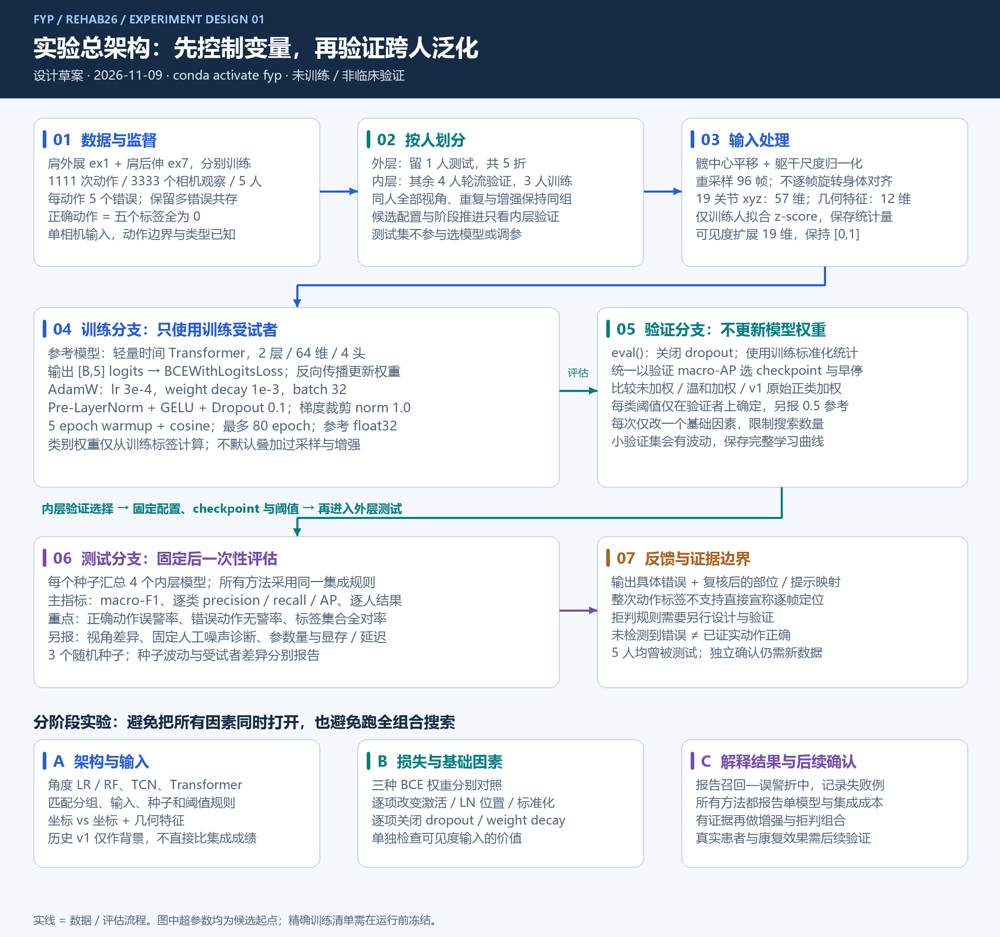
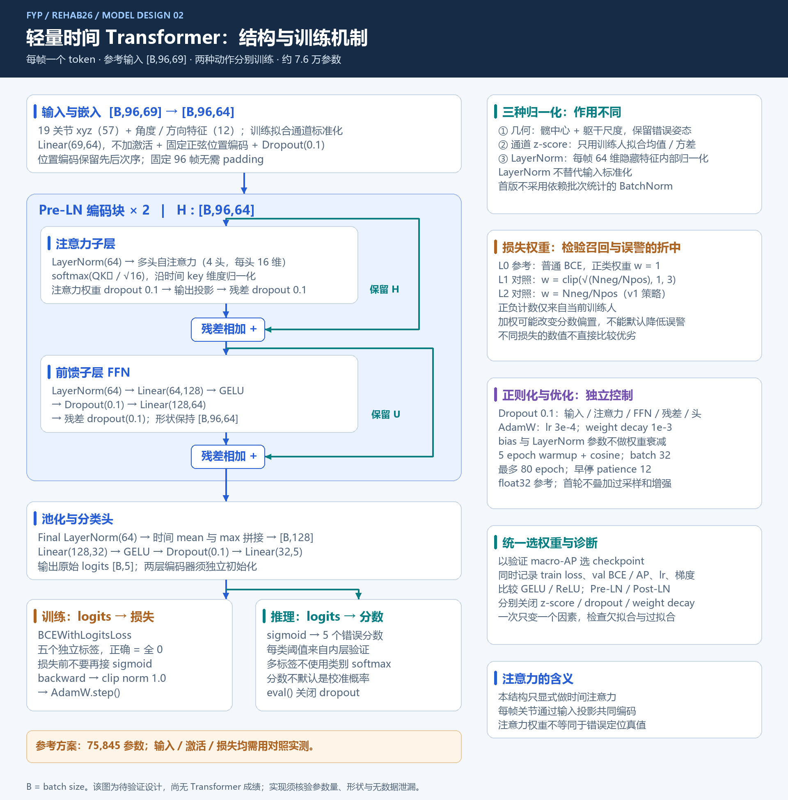

# 康复动作 Transformer：实验架构与训练设计

日期：2026-11-09。状态：**设计草案，未训练、未冻结最终实验清单**。本轮交付架构图、训练决策和环境核验，图中的超参数是候选起点，不是已验证最优值。实验环境指定为 `conda activate fyp`。





## 1. 研究目标与数据依据

目标：在未见受试者上识别肩外展 ex1、肩后伸 ex7 的具体错误，检查轻量 Transformer 是否在相近错误检出水平下降低误警。两种动作**分别训练模型**，首版由用户指定动作和已知动作片段，不包含自动动作识别、连续视频分割或实时逐帧报警。

已有 1111 次物理动作、3333 个摄像头观察、5 名志愿者。每种动作对应 5 个独立错误标签，主要错误与附加错误取并集；正确动作标签为 `[0,0,0,0,0]`。使用五个 sigmoid 的多标签任务，不能用将类别强制互斥的五类或六类 softmax 替代。

现有标签支持整次动作分类。部位提示可来自复核后的错误类型映射，注意力热图不能自动等同于经过真值验证的空间或时间定位。模拟错误数据上的模型表现也不直接证明真实患者康复获益。

## 2. 数据流与三种不同的归一化

1. 原始片段 `[B,L,33,4]`，第四通道是 visibility，不能混入 xyz 几何运算。无穷值、NaN、全零帧、退化躯干尺度显式拒绝并计数，不静默补零。
2. **几何归一化**：逐帧减髋中点，再除以该次动作的躯干长度中位数，减小位置和体形差异。保留身体倾斜与旋转；逐帧身体坐标对齐可能消去需要检测的躯干错误。
3. 沿用 v1：xyz 线性重采样至 96 帧，可见度取相邻源帧的最小值。这一步不保留绝对动作时长；首版不研究速度是否符合处方。
4. 选取 19 个关节：57 维坐标；另有 12 维角度/方向几何特征。参考输入 `[B,96,69]`。坐标单独输入为 57 维，加入 19 维可见度为 88 维；19 个关节和 12 个特征的定义沿用已审计 v1。
5. **通道标准化**：仅使用当前内层训练的 3 人拟合每个坐标/角度通道的均值与标准差，沿样本和时间计算；标准差下限 `1e-4`。保存统计量，验证与测试只应用。可见度扩展保持原始 `[0,1]`，不做 z-score。
6. **网络 LayerNorm**：对每帧的 64 维隐藏表示计算均值和方差，不跨受试者估计总体统计量，也不替代输入标准化。小批量下优先 LayerNorm，首版不引入依赖批次统计的 BatchNorm。

所有输入特征仅来自骨架，不把参与者、正确性、身体朝向标签或帧边界元数据作为预测特征。固定 96 帧时无需 padding；将来改为变长序列，注意力与池化必须一起应用 padding mask。

## 3. 模型结构：约 7.6 万参数的时间 Transformer

参考输入 `X:[B,96,69]`；**一个 token 是一帧的全身选定特征，并非一个关节**。

```text
Linear(69,64) + 固定正弦位置编码 -> Dropout(0.1)
  -> Pre-LN Transformer Block × 2
  -> Final LayerNorm(64)
  -> 时间 Mean Pool 与 Max Pool 拼接 [B,128]
  -> Linear(128,32) -> GELU -> Dropout(0.1)
  -> Linear(32,5) -> logits [B,5]
```

每个 Pre-LN 块：

```text
U = H + Dropout(MHSA(LayerNorm(H)))
H_next = U + Dropout(Linear_128_to_64(Dropout(GELU(Linear_64_to_128(LayerNorm(U))))))
```

注意力为 4 个头，每头维度 16；`softmax(QKᵀ / sqrt(16))` 在时间 key 维度上计算，注意力权重 dropout=0.1。FFN 隐藏层 dropout、两个残差支路 dropout 和输入 dropout 均为 0.1。残差相加后不额外接 ReLU。最后一个编码块后还有 final LayerNorm。

参考参数量 **75,845**（线性层含 bias；LayerNorm 含仿射参数；固定位置编码无训练参数；2 个编码块）。57 维坐标输入时为 75,077；88 维含可见度输入时为 77,061。本轮已在 fyp 环境用对应 PyTorch 模块核对参考参数量及 `[2,96,69] → [2,5]` 前向形状；这不代表完成训练或完整模型实现。

PyTorch `TransformerEncoderLayer` 对应关键选项为 `batch_first=True, norm_first=True, activation='gelu', d_model=64, nhead=4, dim_feedforward=128, dropout=0.1`。还需显式设置最终 LayerNorm。若通过克隆构造多层 Encoder，应独立初始化各层，不让所有层起始权重完全相同。

## 4. 损失、激活与类别不平衡

参考损失使用未加权 `BCEWithLogitsLoss(reduction='mean')`。它对 batch 与五个标签取平均，直接接收 logits。**训练损失前不再手动 sigmoid**；推理时才应用 sigmoid。输出层不使用 ReLU、GELU 或类别 softmax。

令第 c 类的 logit 为 `z_c`，`p_c=sigmoid(z_c)`，则单标签损失为：

`L_c = -[w_c*y_c*log(p_c) + (1-y_c)*log(1-p_c)]`。

实现必须使用数值稳定的 logits 版本。所有正确动作的五个零标签也是有效训练监督，不能丢弃。

比较三种正类权重，其余配置保持一致：

| 配置 | w_c | 动机与潜在影响 |
|---|---|---|
| L0 参考 | 1 | 先观察普通 BCE 的召回与误警，不预先强推正类 |
| L1 温和加权 | `clip(sqrt(Nneg/Npos),1,3)` | 适度提高稀有错误的损失贡献，检查折中 |
| L2 沿用 v1 | `Nneg/Npos` | 与早期策略对照，可能提高召回，也可能增加误警 |

计数只用当前内层训练标签；若任何类别没有正样本，报错并重新审视协议，不能靠除数截断伪装成可训练类别。类别加权会改变最优分数的偏置，`sigmoid=0.8` 不自动表示 80% 的正确概率。现有误警不能未经实验就归因于损失权重。

GELU 是参考隐藏激活，单独比较 ReLU；注意力中的 softmax、输出的 sigmoid、隐藏层的 GELU 作用不同，不能互换。首轮不同时增加 focal loss、label smoothing、过采样和加权 BCE，避免无法解释收益来源。

## 5. 优化、正则化与训练稳定性

| 项目 | 参考候选 | 要记录的影响 |
|---|---|---|
| 优化器 | AdamW，lr=`3e-4`，betas=`(0.9,0.999)`，eps=`1e-8` | 学习率过高可能震荡，过低可能在预算内欠拟合 |
| Weight decay | `1e-3`；只作用于线性/注意力权重矩阵，bias 与 LayerNorm 参数不衰减 | 属于优化器的解耦权重衰减；不额外再加一次 L2 惩罚 |
| Dropout | 输入、注意力、FFN、残差、分类头均为 0.1 | 小数据上可能减轻过拟合；训练过强也会欠拟合；验证/推理必须 `eval()` |
| 学习率计划 | 前 5 epoch 从 lr/5 线性 warmup 至 lr，再 cosine 至 `1e-5` | 固定最大 80 epoch，每个 epoch 完成更新后调整下一轮 lr |
| Batch size | 32，`drop_last=False` | 显存、优化噪声和每轮更新数相关；对照时不能悄悄改变 |
| 梯度裁剪 | 全局 norm=1.0，backward 后、step 前 | 限制梯度爆发，记录裁剪前 norm 与非有限梯度 |
| 早停与选权重 | 验证 macro-AP 最大，min_delta=`1e-4`，patience=12，第 5 epoch 后开始累计 patience | 所有损失使用同一选权重标准，避免直接比较不同尺度的损失值；平局选较早 checkpoint |
| 精度 | float32，参考实验关闭 AMP | 减少首轮数值变量；若以后启用 AMP，先 unscale 再 clip，单独记录 |
| 随机性 | 3 个种子；固定 Python/NumPy/PyTorch/DataLoader，记录确定性及 TF32 配置 | 分开报告种子波动与受试者差异，不宣称跨设备逐位复现 |
| 数据增强 | 参考不使用 | 噪声可能改变轻微错误标签；后续需单独定义幅度与合理性 |

每轮记录训练目标损失、验证未加权 BCE、验证 macro-AP、学习率、梯度范数及耗时。macro-AP 对阈值独立，适合统一选 checkpoint，但小验证集上也会波动，需保留完整曲线，不能把它当作无噪声标准。训练与验证都差提示欠拟合/特征问题，训练好验证差提示泛化问题；解释需要结合实际曲线。

## 6. 划分、选配置与阈值

外层轮流留 1 人测试；另外 4 人分别轮流作为内层验证，余下 3 人训练。每个模型候选每个种子有 `5×4=20` 次拟合；2 个动作、3 个种子共 120 次拟合。传统确定性模型不重复制造无意义的种子波动。阶段推进时可先用预设单种子做内层筛查，再对预先选出的少量配置做 3 种子确认；精确清单须在训练前冻结。

同一人的全部相机、重复、动作与增强都在同一侧。标准化、类别权重、选权重、阈值均在当前训练/验证范围内完成；统计量不能从全量缓存整体拟合。

每个外层测试者的超参数依据其余人的**内层验证汇总**选择。固定这些配置后，保留四个内层模型，对外层测试做四模型集成，每个种子独立报告。所有参与比较的方法都采用相同集成规则，同时报告单内层模型结果和计算代价。不能拿新方法四模型集成与历史 v1 单模型直接宣称架构增益。

每个内层模型、每类阈值只在自己的验证人上，从 `0.05,0.10,...,0.95` 最大化 F1；平局先接近 0.5，再选较小阈值。外层集成决策使用各模型的 `p_c - t_c` 平均后是否 ≥0；同时保存平均原始分数用于排序/AP分析。该差值只是一致定义的分类规则，不是已校准置信度。另保留固定 0.5 阈值诊断，区分表示改善与阈值改变。

早停、阈值和配置都反复使用小规模内层验证集，仍有选择过拟合风险；限制候选数量，公开完整选择过程。外层测试只用于预定报告，不能根据它决定下一阶段胜者。五名参与者已经出现在已查看的早期测试中，因此整轮属于探索性方法开发；新受试者或兼容外部数据才提供更独立的确认。

拒判/可靠性作为后续单独模块，第一轮不把阈值距离包装成可靠置信度。若启用，必须另行冻结校准/拒判规则，并同时报告全样本成绩、保留成绩、覆盖率、拒判比例、误警与漏警。未检测到错误不等于证实动作正确。

## 7. 分阶段对照：避免全组合搜索

| 阶段 | 比较 | 控制与判定 |
|---|---|---|
| A 输入与架构 | 角度 LR、角度 RF；TCN xyz / xyz+angles；Transformer xyz / xyz+angles | 同源样本、同分组、同种子预算、同阈值规则与集成；历史 v1 仅作背景，需重跑匹配对照 |
| B 损失 | L0 / L1 / L2 | 同一网络与输入，观察 precision、recall、误警及 AP；不直接跨损失比较 loss 数值 |
| C 基础因素 | 各自单独替换：GELU→ReLU；Pre-LN→Post-LN；去掉通道 z-score；dropout→0；weight decay→0；加入 visibility | 每次仅改一个因素，以参考配置为锚；Post-LN 保持层数与最终 LN，明确记录拓扑；去 z-score 仍保留几何归一化 |
| D 可选鲁棒训练 | 一项预先定义的姿态扰动增强 | 先检验标签是否合理保留；原始测试和固定人工噪声诊断分开报告 |

注意：现有 TCN 用 ReLU+GroupNorm，新 Transformer 用 GELU+LayerNorm，A 阶段比较的是完整架构方案。若要声称收益专门来自注意力，还需后续匹配激活/归一化、优化预算和容量的控制，不能把所有差异都归功于 Transformer。

不运行所有因素的笛卡尔积。阶段 B/C 的候选推进只看内层验证；需要验证组合交互时，再预先定义小规模组合实验。当前草案未承诺所有候选都必须进入完整 120 次拟合。

## 8. 评估与交付

主报告包含 macro-F1、逐错误 precision/recall/F1/AP、正确动作误警率、错误动作无警率、标签集合全对率和逐人结果。相近召回下比较误警时，工作点在验证数据上选，测试报告实际达到的召回与误警；不能在测试曲线上选最有利阈值作为部署成绩。

分开记录种子变化、五名测试者的差异和视角差异。相机观察相关，不以 3333 个独立样本做显著性推断。报告参数量、峰值显存、包含明确输入范围的推理耗时；GPU 计时预热并同步，不能只测异步提交时间。

未来训练产物应包括数据/代码哈希、每次划分、标准化统计、正类权重、初始化及随机种子、实际环境、checkpoint、学习曲线、全部预测、阈值、失败样本及拒绝输入计数。

## 9. 指定环境与当前核验

本机默认 PowerShell 未加载 conda 命令，先初始化 hook 后已成功激活指定环境：

```powershell
& 'D:\conda\shell\condabin\conda-hook.ps1'
conda activate fyp
python -c "import sys, torch; print(sys.executable); print(torch.__version__); print(torch.cuda.is_available())"
```

实际 Python：`D:\conda\envs\fyp\python.exe`，Python 3.13.16，PyTorch `2.11.0+cu128`，CUDA runtime 12.8，RTX 4050 Laptop GPU 可用；NumPy 2.5.3，Pillow 12.3.0。图像在该环境生成。本轮检查缺少 `scikit-learn`，因此当前不能直接在此环境复跑 LR/RF 对照；正式训练前需补齐兼容依赖并另存版本快照，本轮未修改环境依赖。

本设计的机器可读草案为 `experiments/rehab26_transformer_v2_design/protocol.draft.json`，环境快照为同目录 `environment_check.json`。图源生成器为 `tools/render_transformer_design.py`，输出 PNG 与可编辑 SVG。生成命令：

```powershell
conda activate fyp
python tools/render_transformer_design.py
```

不改写 v1 的协议、缓存、权重与结果；该草案不能冒充已完成训练。
