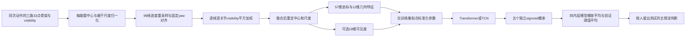
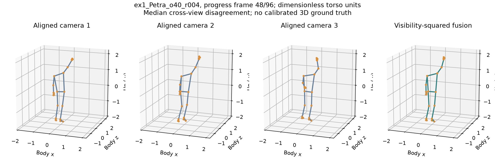
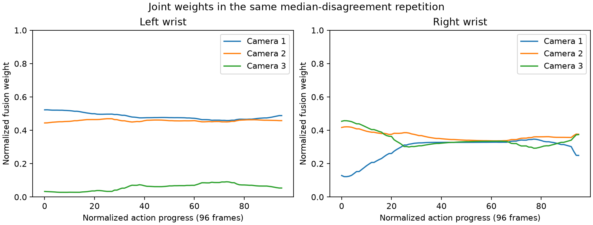

# REHAB26 三视图基础融合与 v2 实验重跑

2026-11-10，环境 `conda activate fyp`，RTX4050。本轮先检查GitHub现有融合实现，再用融合骨架重跑v2模型对照。已检查的代码与适配判断见 `literature/2026-11-10_skeleton_fusion/REVIEW_zh.md`。

**已完成全部984次正式拟合、测试和模型核验。** 简要结论见[FINDINGS_zh.md](FINDINGS_zh.md)，全部指标见[RESULTS_zh.md](RESULTS_zh.md)。冻结报告中的“昨日”指2026-11-09启动的v2单视角实验；报告和核验文件保持原始版本。加权骨架融合较旧单视角汇总提高F1，但未超过旧三视角概率融合；等权肩后伸在首种子参考网络上更好，仍待多种子确认。

首页最佳结果的具体设定、数据/论文来源和指标定位见[BEST_SETTINGS_zh.md](BEST_SETTINGS_zh.md)；逐种子证据见[best_results.json](best_results.json)，由`export_best_results.py`直接从完整汇总提取。

## 数据与融合

三个相机的 MediaPipe 单目 world landmarks，按同次动作标注关联。每路独立做髋中心平移、整次动作躯干尺度归一化和 96 帧进度重采样；由髋部水平轴估计整次动作固定 yaw，保留原 y 轴与动作内相对转动，再按逐关节 visibility 平方权重平均。融合后重新定中心和尺度，重新计算原有特征。此处假设各相机竖直方向近似一致，没有通过标定估计 roll/pitch，也没有测得真实重力轴。

不需要 K/R/t；不使用真实错误标签、参与者身份或官方朝向数值做融合。没有逐帧精确时间配准、三角测量或动捕真值。等权和 visibility² 都可能平均掉不一致的姿态；没有据此声称更高三维精度。

数据输出 `data/REHAB26-ViewAngles/processed_fusion_v3/`：1111 个物理动作，每次只有一个融合样本，特征缓存 `[1111,96,88]`。`x` 是平方权重融合，`x_equal` 是等权融合，`x_cam2` 是相同 yaw 对齐的单 cam2。包含五错误多标签，正确动作全零。旧 `processed_v1` 和 v2 权重/预测不改写。



参考 Transformer 使用两层64维、4头注意力、GELU、Pre-LN、均值/最大池化、dropout=0.1和无类别加权的`BCEWithLogitsLoss`；模型输出logits，推理才转sigmoid。候选分别改变激活、类别权重、输入标准化、LayerNorm位置、dropout、AdamW权重衰减、学习率、容量与特征。每个内层仅用三名训练者拟合标准化和模型，用一名验证者选择早停/阈值；外层测试者始终独立。

## 模型与选择协议

复用 v2 的 `core.py`、`train.py` 和 `suite.py` 中模型、损失、优化器、学习率调度、标准化、早停、阈值及四内层集成函数。外层五人留一测试，内层四人轮流验证、三人训练；三视图先融合后始终按人分组。

- 与 v2 相同的 16 候选，首种子 40 个动作/外层/内层组合，共 640 次筛查拟合。
- 与 v2 相同的验证规则：单因素相对参考 AP 提高至少 0.015，才生成结构/训练/合并配置；组合数量由验证决定，不预设必须等于v2的48次。
- 每外层最终 Transformer、TCN、RF 补两个种子，共 240 次确认；LR 和参考 Transformer 首种子。
- 两个固定输入对照：等权融合、yaw 对齐 cam2，各用参考 Transformer 在全部40划分训练，合计80次，首种子。
- 完成选择、确认与全部对照训练后，才生成新的外层测试预测。训练数据是每次动作一个样本，因此每 epoch 的更新次数比原单视图方案少；保留原 epoch/早停预算，没有用复制样本凑回三倍数量。

比较主表仍采用各种子汇总外层的 macro-F1/AP、误警、漏警、逐类和逐人结果。另把v2保存的三个视角预测按物理动作平均，提供不重训的决策融合对照：同时报告沿用旧阈值，以及先在每个旧内层验证集平均三路概率、按v2网格/F1规则重选阈值再平均四个内层阈值两版。没有用测试集挑阈值；两版规则及主配对比较采用验证重选版的决定，在新测试释放前记录于`runs/rehab26_fusion_v3/historical_late_calibration_plan.json`。该对照使用三相机，不与单相机系统混称为相同输入预算。旧训练采用三倍观察，与融合重训的训练更新次数也不同，因此结果反映整体方案变化。

## 执行

前置依赖：先按[统一复现说明](../../docs/REPRODUCIBILITY_zh.md)准备原始数据、审计索引和`processed_v1`缓存，再构建融合数据。完整比较分析还需要本地v2验证/测试预测；只有v3训练输出不足以重建历史概率融合表。下面的命令用于实际复现，会写入本地运行目录。

```powershell
& 'D:\conda\shell\condabin\conda-hook.ps1'
conda activate fyp
python -X utf8 experiments/rehab26_fusion_v3/prepare.py
python -X utf8 experiments/rehab26_fusion_v3/verify_fusion.py
python -X utf8 experiments/rehab26_fusion_v3/run.py smoke
python -X utf8 experiments/rehab26_fusion_v3/run.py all --workers 2
python -X utf8 experiments/rehab26_fusion_v3/verify_models.py
python -X utf8 experiments/rehab26_fusion_v3/analyze.py
python -X utf8 experiments/rehab26_fusion_v3/visualize_fusion.py
```

几何核验覆盖已知 yaw/平移/尺度、倾斜与相对旋转保留、视图顺序、低可见度异常关节与零权重回退。另检查40个人物互斥划分，并从原始数据重算10次动作。源文件、缓存、协议哈希绑定运行身份，不能更换输入后静默复用已完成权重。

运行目录 `runs/rehab26_fusion_v3/`，每次拟合保存权重、学习曲线、验证预测、阈值和人物划分；`progress.json` 与 `training.log` 记录实际进度。研究仍基于五名已参与探索的志愿者，当前是融合可行性比较。

`analyze.py --historical-only` 可先计算v2保存预测的概率平均，不读取本轮测试结果。完整分析输出 `RESULTS_zh.md`、`results_summary.json` 和 `figures/`；逐人、逐类、验证因素与输入对照都保留。`verify_models.py` 逐个重新加载本轮所有主实验和对照模型，重算训练集标准化及验证预测，另核验10次从三路原始骨架到外层四模型集成的推理。

原始片段推理复现示例（自动选用该受试者从未参与训练/验证的外层模型）：

```powershell
python -X utf8 experiments/rehab26_fusion_v3/infer.py --sample-id ex1_Petra_o40_r004
```

下图选取1111次动作中跨视图偏差中位数的一次动作，以相同尺度展示对齐后的三路与融合结果；不根据分类成绩选择示例。




