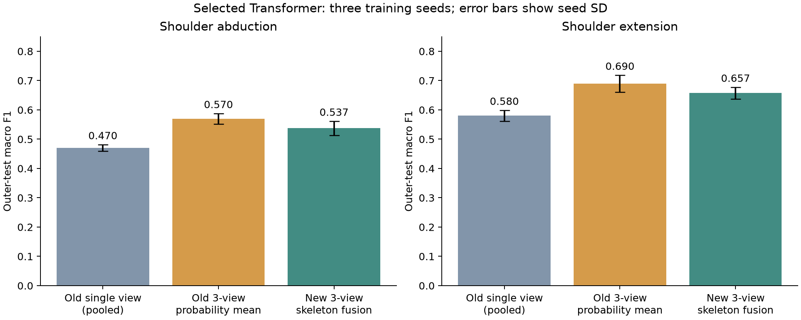
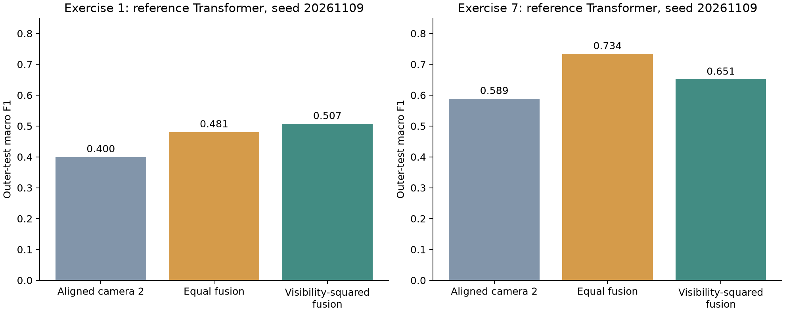
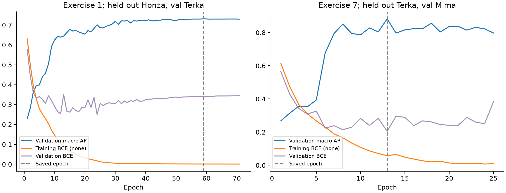

# REHAB26 三视图基础融合实验结果

日期：2026-11-10。环境：conda fyp，RTX4050。

本轮把同次动作的三路 MediaPipe 单目三维骨架融合为一个输入，重跑昨日的 LR、RF、TCN 和 Transformer。融合不是标定三维重建：每路髋中心/躯干尺度归一化、96帧动作进度配对、整次动作固定髋方向 yaw 对齐，再逐关节 visibility² 加权。没有新增精确时间同步。

## Transformer 主比较

macro-F1/AP 是汇总五个外层受试者后逐类计算，再跨三个训练种子取均值；±是种子样本标准差(ddof=1，与v2一致)，不能解释为人群置信区间。误警是正确动作被报任一错误，漏警是有错误动作没有报任何错误。

| 动作 | 输入方案 | macro-F1 | macro-AP | 误警 | 漏警 |
|---|---|---|---|---|---|
| 肩外展 | 昨日单视角观察汇总 | 0.470 ± 0.012 | 0.493 ± 0.009 | 43.0% | 27.8% |
| 肩外展 | 昨日三视角概率平均（沿用阈值） | 0.561 ± 0.021 | 0.635 ± 0.013 | 32.5% | 29.4% |
| 肩外展 | 昨日三视角概率平均（验证重选阈值） | 0.570 ± 0.018 | 0.635 ± 0.013 | 44.1% | 21.3% |
| 肩外展 | 本轮骨架加权融合 | 0.537 ± 0.024 | 0.588 ± 0.004 | 44.2% | 18.0% |
| 肩后伸 | 昨日单视角观察汇总 | 0.580 ± 0.019 | 0.637 ± 0.011 | 25.3% | 24.2% |
| 肩后伸 | 昨日三视角概率平均（沿用阈值） | 0.664 ± 0.019 | 0.756 ± 0.016 | 10.1% | 26.6% |
| 肩后伸 | 昨日三视角概率平均（验证重选阈值） | 0.690 ± 0.029 | 0.756 ± 0.016 | 20.9% | 14.4% |
| 肩后伸 | 本轮骨架加权融合 | 0.657 ± 0.021 | 0.728 ± 0.006 | 30.2% | 11.2% |

昨日单视角汇总以3333个相机观察为单位；概率平均和本轮融合均以1111次物理动作为单位（肩外展556次，肩后伸555次）。概率平均直接复用昨日保存的三路预测：一版沿用原阈值，另一版先对每个内层验证集的三视角概率取平均，再沿用v2网格/F1规则选择阈值，最后平均四个内层阈值；没有重训或用测试集挑阈值。两版都报告，后续逐人配对和主图预先指定使用验证重选阈值版，规则冻结于新测试释放前。历史原始指标与v2报告逐项核对；概率融合的每次动作标签与本轮标签逐项核对。

## 相同参考网络的输入对照

三种输入均用相同参考 Transformer、首种子、40个内层划分和每次动作一个样本；对比加权、等权与同样预处理的单cam2。此表不等于上表各外层独立选出的最佳配置。

| 动作 | 输入 | macro-F1 | macro-AP | 误警 | 漏警 |
|---|---|---|---|---|---|
| 1 | 对齐后单cam2 | 0.400 | 0.443 | 45.0% | 33.1% |
| 1 | 三路等权 | 0.481 | 0.496 | 48.6% | 19.4% |
| 1 | 三路visibility² | 0.507 | 0.551 | 51.1% | 14.4% |
| 7 | 对齐后单cam2 | 0.589 | 0.640 | 25.5% | 20.6% |
| 7 | 三路等权 | 0.734 | 0.784 | 19.1% | 9.7% |
| 7 | 三路visibility² | 0.651 | 0.715 | 27.3% | 15.2% |

## 融合输入下的模型对照

| 动作 | 模型 | macro-F1 | macro-AP | 误警 | 漏警 |
|---|---|---|---|---|---|
| 1 | angle_lr | 0.595 | 0.674 | 54.3% | 10.8% |
| 1 | angle_rf | 0.545 ± 0.008 | 0.580 ± 0.005 | 65.1% | 12.2% |
| 1 | selected_tcn | 0.527 ± 0.045 | 0.575 ± 0.035 | 40.4% | 20.0% |
| 1 | reference_transformer | 0.507 | 0.551 | 51.1% | 14.4% |
| 1 | selected_transformer | 0.537 ± 0.024 | 0.588 ± 0.004 | 44.2% | 18.0% |
| 7 | angle_lr | 0.643 | 0.675 | 31.3% | 13.7% |
| 7 | angle_rf | 0.657 ± 0.005 | 0.666 ± 0.002 | 29.1% | 13.8% |
| 7 | selected_tcn | 0.598 ± 0.021 | 0.662 ± 0.017 | 33.8% | 17.8% |
| 7 | reference_transformer | 0.651 | 0.715 | 27.3% | 15.2% |
| 7 | selected_transformer | 0.657 ± 0.021 | 0.728 ± 0.006 | 30.2% | 11.2% |

## 每位测试者的变化

下表先对种子取均值；参与者只有5位，个体差异比种子差异更值得关注。

| 动作 | 人 | 昨日概率融合F1 | 本轮骨架融合F1 | 差值 |
|---|---|---|---|---|
| 1 | Honza | 0.742 | 0.689 | -0.054 |
| 1 | Mima | 0.541 | 0.406 | -0.135 |
| 1 | Petra | 0.672 | 0.634 | -0.038 |
| 1 | Terka | 0.399 | 0.398 | -0.002 |
| 1 | Vasil | 0.415 | 0.393 | -0.023 |
| 7 | Honza | 0.711 | 0.687 | -0.024 |
| 7 | Mima | 0.710 | 0.726 | +0.016 |
| 7 | Petra | 0.746 | 0.769 | +0.023 |
| 7 | Terka | 0.633 | 0.629 | -0.004 |
| 7 | Vasil | 0.580 | 0.515 | -0.064 |

## 错误类别

选定Transformer在本轮融合输入上的逐类F1/AP为三个种子均值；support按物理动作计。

| 动作 | 类别 | support | F1 | AP |
|---|---|---|---|---|
| 1 | ERR_ARM_FORWARD | 56 | 0.706 | 0.692 |
| 1 | ERR_ELEVATED_SHOULDER | 74 | 0.396 | 0.462 |
| 1 | ERR_HEAD_TO_SIDE | 62 | 0.411 | 0.560 |
| 1 | ERR_LOW_ABDUCTION | 55 | 0.704 | 0.718 |
| 1 | ERR_BENT_ARM | 64 | 0.470 | 0.508 |
| 7 | ERR_TORSO_FORWARD | 61 | 0.908 | 0.978 |
| 7 | ERR_ELEVATED_SHOULDER | 55 | 0.406 | 0.416 |
| 7 | ERR_TORSO_ROTATION | 55 | 0.922 | 0.986 |
| 7 | ERR_BENT_ARM | 56 | 0.570 | 0.693 |
| 7 | ERR_ARM_TO_SIDE | 56 | 0.480 | 0.566 |

## 损失、激活、归一化和正则化的验证结果

保持昨日候选网格和选择规则。下表为每动作20个内层划分相对参考Transformer的平均验证AP差；属于验证证据，不根据外层测试继续调参。参考使用无类别加权的BCEWithLogitsLoss、GELU、Pre-LN、训练集标准化、dropout=0.1与AdamW(weight_decay=0.001，仅矩阵参数)。损失对照包括按训练标签计算的原始正负比权重，以及平方根后截断到[1,3]的权重。输出五个独立sigmoid概率；没有softmax互斥假设。

| 动作 | 候选 | AP差 | AP提高划分数/20 |
|---|---|---|---|
| 1 | tr_ref | +0.000 | 0 |
| 1 | tr_xyz | -0.081 | 4 |
| 1 | tr_sqrt | -0.010 | 7 |
| 1 | tr_raw | -0.010 | 8 |
| 1 | tr_relu | -0.002 | 11 |
| 1 | tr_postnorm | -0.000 | 11 |
| 1 | tr_noz | -0.252 | 0 |
| 1 | tr_nodrop | +0.015 | 14 |
| 1 | tr_nodecay | -0.000 | 3 |
| 1 | tr_visibility | -0.042 | 8 |
| 1 | tr_lr1e3 | +0.025 | 14 |
| 1 | tr_small | -0.163 | 3 |
| 7 | tr_ref | +0.000 | 0 |
| 7 | tr_xyz | +0.008 | 13 |
| 7 | tr_sqrt | -0.009 | 6 |
| 7 | tr_raw | -0.008 | 5 |
| 7 | tr_relu | +0.004 | 9 |
| 7 | tr_postnorm | -0.000 | 12 |
| 7 | tr_noz | -0.308 | 0 |
| 7 | tr_nodrop | +0.007 | 13 |
| 7 | tr_nodecay | -0.000 | 3 |
| 7 | tr_visibility | -0.007 | 8 |
| 7 | tr_lr1e3 | +0.025 | 16 |
| 7 | tr_small | -0.092 | 4 |

候选含义：`tr_xyz`只用坐标；`tr_sqrt/raw`改变正类权重；`tr_relu`改变激活；`tr_postnorm`改为Post-LN；`tr_noz`关闭输入标准化；`tr_nodrop/nodecay`分别关闭dropout/weight decay；`tr_visibility`增加19维可见度；`tr_lr1e3`学习率改为0.001；`tr_small`改为单层32维。参考输入为57维关节坐标+12维几何特征。全部配置保存在`protocol.final.json`。

各外层最终配置：

| 动作 | 测试者 | Transformer | TCN |
|---|---|---|---|
| 1 | Honza | iter_ex1_Honza_training | tcn_angles |
| 1 | Mima | tr_lr1e3 | tcn_angles |
| 1 | Petra | iter_ex1_Petra_training | tcn_angles |
| 1 | Terka | iter_ex1_Terka_training | tcn_angles |
| 1 | Vasil | tr_lr1e3 | tcn_angles |
| 7 | Honza | tr_xyz | tcn_angles |
| 7 | Mima | tr_lr1e3 | tcn_angles |
| 7 | Petra | iter_ex7_Petra_combined | tcn_angles |
| 7 | Terka | iter_ex7_Terka_combined | tcn_angles |
| 7 | Vasil | tr_lr1e3 | tcn_angles |

## 运行与适用范围

共完成904次主实验拟合和80次输入对照拟合；另有一次小规模smoke。640次基础筛查、验证生成的组合、240次额外种子确认、80次输入对照均在新外层测试预测前完成。人物划分、阈值、标准化和早停继续复用v2实现。

融合后每次动作仅一个训练样本；原先每次动作三个相机观察，因此同样epoch预算下的梯度更新次数不同。主表反映融合与训练方案的整体变化。参考输入对照更适合判断当前加权/等权融合是否有帮助。

visibility是可见度，不保证三维精度；共同偏差、髋方向估计误差和近似进度配对都可能削弱融合。数据只有5位已用于探索的志愿者；没有临床患者泛化或三维真值结论。synthetic noise只在融合后施加右臂扰动，不作为相机遮挡实验。

GitHub适配核查见[检索记录](../../literature/2026-11-10_skeleton_fusion/REVIEW_zh.md)。未直接复用需要K/R/t的三角测量代码；独立实现并验证了适用于现有输入的加权数学运算。

结构化明细：`results_summary.json`；运行权重/预测/阈值：`runs/rehab26_fusion_v3/`。几何与模型重载结果分别保存在`fusion_verification.json`和`model_verification.json`。
