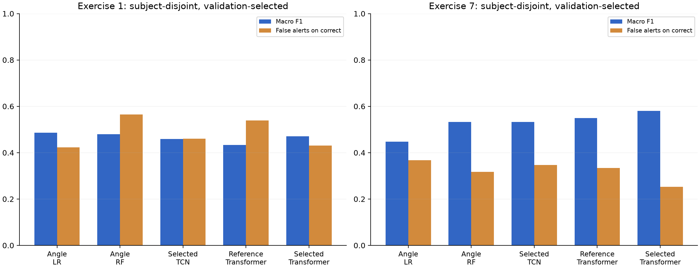
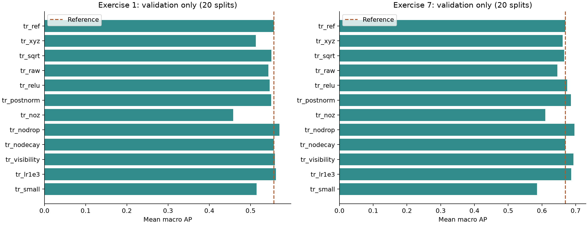
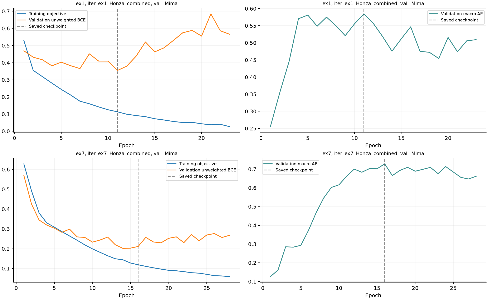

# REHAB26 Transformer v2 实际实验结果

2026-11-09 启动，结果由实际权重与预测生成。探索性研究：5 名模拟错误志愿者，已知动作与动作边界；尚无独立患者或临床疗效验证。

## 协议与选择

外层留一人测试，内层其余四人轮流验证、三人训练。16 个配置先做单种子筛查；第二轮只在对应内层验证改善时组合因素。先保存最终选择，再补种子，最后计算外层测试。相同人的全部视角和重复保持同组。

表中 F1 是各种子汇总全部外层观察后的宏 F1 的均值；±SD 仅表示三种子变化。LR 和参考 Transformer 只有一个种子。所有方法均在每个外层使用四个内层模型集成；不能与 v1 单模型数字直接归因比较。

## 主结果

| 动作 | 方法 | 宏F1（种子均值±SD） | 宏AP | 正确动作误警率 | 错误动作无警率 | 标签集合全对 |
|---|---|---:|---:|---:|---:|---:|
| ex1 | Angle LR | 0.486 | 0.494 | 42.3% | 24.9% | 46.3% |
| ex1 | Angle RF | 0.480 ± 0.007 | 0.520 | 56.5% | 22.1% | 38.5% |
| ex1 | Selected TCN | 0.459 ± 0.032 | 0.492 | 46.0% | 26.1% | 43.5% |
| ex1 | Reference Transformer | 0.433 | 0.464 | 54.0% | 23.4% | 38.7% |
| ex1 | Selected Transformer | 0.470 ± 0.012 | 0.493 | 43.0% | 27.8% | 47.0% |
| ex7 | Angle LR | 0.448 | 0.454 | 36.8% | 26.1% | 46.3% |
| ex7 | Angle RF | 0.532 ± 0.004 | 0.569 | 31.8% | 23.4% | 53.9% |
| ex7 | Selected TCN | 0.532 ± 0.011 | 0.565 | 34.7% | 24.3% | 57.4% |
| ex7 | Reference Transformer | 0.549 | 0.595 | 33.5% | 20.3% | 57.7% |
| ex7 | Selected Transformer | 0.580 ± 0.019 | 0.637 | 25.3% | 24.2% | 63.7% |

## 验证选定的配置

| 动作 | 外层测试者 | Transformer | TCN |
|---|---|---|---|
| ex1 | Honza | iter_ex1_Honza_combined | tcn_angles |
| ex1 | Mima | tr_nodrop | tcn_angles |
| ex1 | Petra | tr_visibility | tcn_angles |
| ex1 | Terka | tr_nodrop | tcn_angles |
| ex1 | Vasil | tr_nodrop | tcn_angles |
| ex7 | Honza | iter_ex7_Honza_combined | tcn_angles |
| ex7 | Mima | tr_nodrop | tcn_angles |
| ex7 | Petra | iter_ex7_Petra_training | tcn_xyz |
| ex7 | Terka | iter_ex7_Terka_combined | tcn_angles |
| ex7 | Vasil | iter_ex7_Vasil_combined | tcn_angles |

完整配置见运行目录 protocol.final.json。不同外层允许选择不同配置，成绩对应整个嵌套选择流程，不是一个固定配置在所有人上的成绩。

## 偏向精确率的预设工作点

F0.5 阈值与 F1 阈值分别仅在内层验证者上选定。以下是同一模型改变工作点后的结果，未据测试成绩再改阈值。

| 动作 | Transformer 宏F1 | 正确动作误警率 | 错误动作无警率 |
|---|---:|---:|---:|
| ex1 | 0.456 | 25.0% | 43.1% |
| ex7 | 0.559 | 12.5% | 36.8% |

降低误警时要同时检查漏警，不能只提高阈值后宣称整体改善。分数未经校准，未实现经过验证的拒判模块。

## 按受试者结果

| 动作 | 受试者 | Transformer F1 | 误警率 | 无警率 |
|---|---|---:|---:|---:|
| ex1 | Honza | 0.554 | 61.6% | 11.1% |
| ex1 | Mima | 0.431 | 62.9% | 11.3% |
| ex1 | Petra | 0.573 | 39.0% | 19.4% |
| ex1 | Terka | 0.391 | 26.1% | 46.3% |
| ex1 | Vasil | 0.324 | 25.7% | 51.0% |
| ex7 | Honza | 0.627 | 2.8% | 29.3% |
| ex7 | Mima | 0.589 | 30.3% | 14.6% |
| ex7 | Petra | 0.601 | 3.8% | 41.6% |
| ex7 | Terka | 0.598 | 28.1% | 20.0% |
| ex7 | Vasil | 0.427 | 60.4% | 16.0% |

## 基础因素消融与训练诊断

下图仅汇总验证指标，不用测试选择激活、损失、归一化或正则化。20 个分组结果相关，均值差不代表统计显著。组合实验另存迭代计划，不能把单因素收益简单相加。

学习曲线固定选字母排序第一位外层及内层，未按成功程度挑选。训练目标损失在加权配置中与验证未加权 BCE 尺度不同，不能直接比较绝对大小。

## 逐类错误

| 动作 | 错误 | precision | recall | F1 | AP |
|---|---|---:|---:|---:|---:|
| ex1 | ERR_ARM_FORWARD | 0.529 | 0.552 | 0.538 | 0.602 |
| ex1 | ERR_ELEVATED_SHOULDER | 0.309 | 0.503 | 0.382 | 0.292 |
| ex1 | ERR_HEAD_TO_SIDE | 0.462 | 0.452 | 0.455 | 0.554 |
| ex1 | ERR_LOW_ABDUCTION | 0.552 | 0.618 | 0.577 | 0.585 |
| ex1 | ERR_BENT_ARM | 0.380 | 0.422 | 0.400 | 0.432 |
| ex7 | ERR_TORSO_FORWARD | 0.947 | 0.803 | 0.869 | 0.944 |
| ex7 | ERR_ELEVATED_SHOULDER | 0.308 | 0.461 | 0.362 | 0.338 |
| ex7 | ERR_TORSO_ROTATION | 0.831 | 0.679 | 0.746 | 0.846 |
| ex7 | ERR_BENT_ARM | 0.447 | 0.444 | 0.435 | 0.508 |
| ex7 | ERR_ARM_TO_SIDE | 0.470 | 0.512 | 0.490 | 0.547 |

## 证据边界与产物

- 三种子结果不等于增加受试者人数；三相机也不是独立受试者。没有按相机观察构造独立样本置信区间。
- 五名志愿者均已出现在之前的探索测试中，新一轮嵌套划分不能恢复完全未见的独立确认。
- 三维骨架由姿态估计器产生，固定人工噪声诊断不等同于真实遮挡或摄像头鲁棒性。
- 当前输入是完整动作片段，不能宣称已实现连续视频分割、逐帧定位、实时纠正或患者恢复效果。
- 全量权重、预测、曲线、配置、输入/代码哈希保存在 runs/rehab26_transformer_v2；results_summary.json 为可追溯汇总。
- failures_seed0.csv 导出第一种子全部标签集合不匹配观察，不只展示成功例。
- 若生成全数据部署权重，其使用所有五人，外层测试成绩不能当作这些部署权重的独立成绩；阈值仍是待确认的研究工作点。
